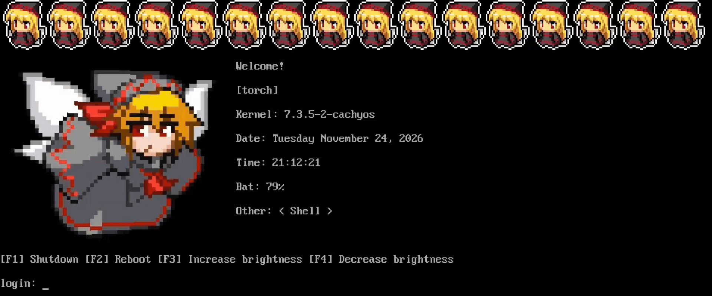

<div align="center">
    <h1 style="margin: 0">
        fbi-dm
    </h1>
</div>

<div align="center">
    Framebuffer image/info display manager
</div>
</br>



## Why do this?
I saw this reddit [reddit post](https://www.reddit.com/r/Gentoo/comments/1g63itl/does_anyone_know_how_to_recreate_this/) that showed a neat little image and promptr
during the boot process. Being a Touhou fan and someone who likes to make things look
cool, I went ahead and tried to make something.

Previously I was using a bash script and [imgfb](https://github.com/sophuric/imgfb) 
to achieve this which worked but only somewhat. It is now being written in C with 
minimal dependencies so I can learn play around with it.

I also get to play with software rendering, framebuffer drawing and packaging which
is neat.

## Installation
To install simply clone, make and make install:
```
git clone https://git.ethanbtst.ca/fbi-dm && cd fbi-dm
make
sudo make install
```

After, disable any display manager on tty and enable `fbi-dm@tty1.service`

### For Arch users
A PKGBUILD is available. Make sure `base-devel` is installed.
```
mkdir fbi-dm && cd fbi-dm
wget https://git.ethanbtst.ca/fbi-dm/plain/PKGBUILD
makepkg -si
```

## Customization
To customize edit `/opt/fbi-dm/config.ini`

By default the images shown are the penguins found when booting the
system (if enabled when building the kernel). The big image will be
your distro's logo if its there.

The spinning image is disabled by default. If enabled, it would
make one rotation every 4 seconds at 24 fps (framebuffer drawing
is slow).

Config options: 
```
small_pic       = path to image
big_pic         = distro or path to image
small_max_h     = maximum small image height in pixels
small_max_w     = maximum small image width in pixels
big_max_h       = maximum big image height in pixels
big_max_w       = maximum big image width in pixels
spin            = bool
rotation_period = seconds per full rotation

top_text        = string
hostname        = bool
kernel          = bool
date            = strftime format
time            = strftime format
battery         = bool
brightness      = bool
```

## Todo
- Try using DRM for KMSCON support?